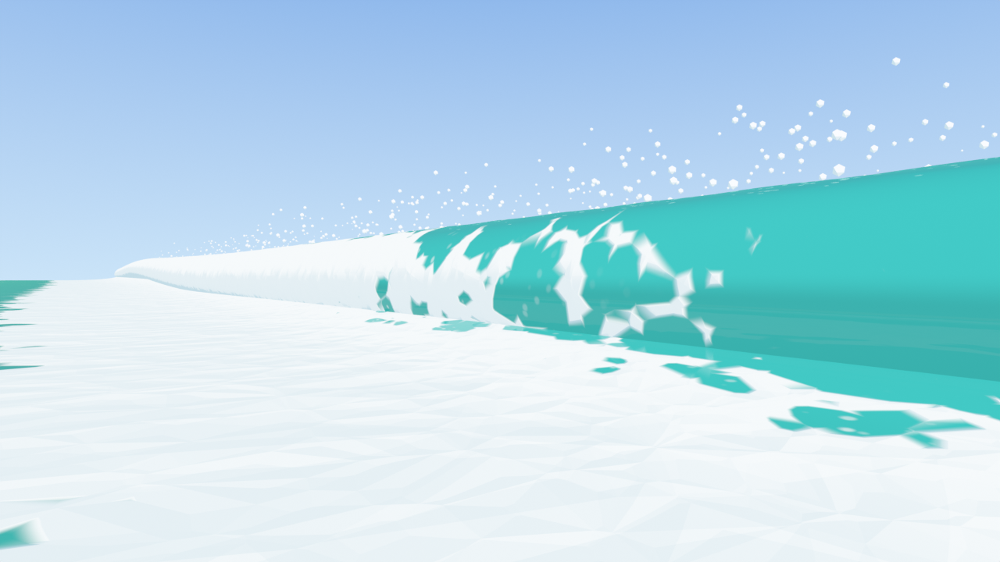

# seafoam
Foam and bubble for fluid Simulation

## Breaking waves and Blender nodes

Research and tools for waves that curl, plunge and break on a beach, and the foam they leave behind.

- **[Research notes](docs/breaking-waves.md):** shoaling, breaking criteria, breaker types, plunging impact
  ("colliding" waves), bores, swash and beach foam, and how films and games fake them.
- **[Blender add-on and tutorial](blender/TUTORIAL.md):** Geometry Nodes for shore waves that shoal, curl and
  run up the sand, foam that lives and fades, spray, sand, and the open-sea Gerstner and Jacobian foam
  nodes. Install [`blender/seafoam_nodes.zip`](blender/seafoam_nodes.zip) from Preferences › Add-ons.
  Tested on Blender 4.5 LTS and 5.0.
- **[Experiments](experiments/):** linear shoaling and breaker types, a 1D shallow-water run-up solver with
  foam, and cross-sections of the Blender breaker.

