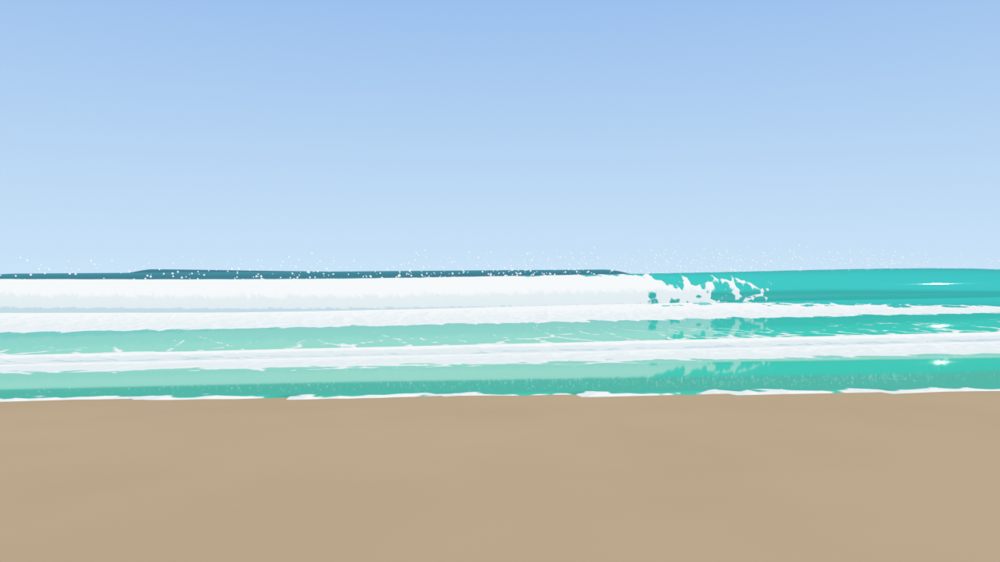
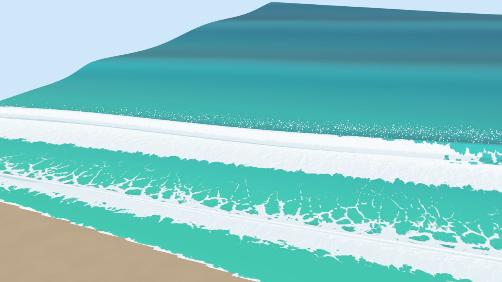
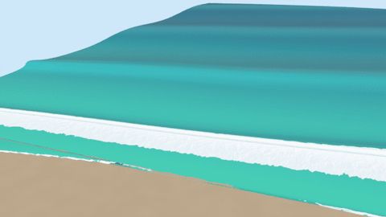
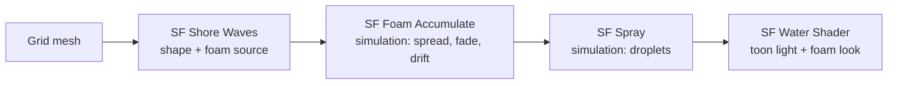

# Seafoam for Blender: breaking waves and stylized foam

Custom Geometry Nodes and shader nodes for stylized surf: waves that shoal, curl, plunge and run up a beach,
with foam that is born, drifts, fades and gets stranded on the sand. The open-sea nodes from Seafoam stage 1
(Gerstner waves with Jacobian whitecaps) are included too.


|  |  |
|---|---|



*Cycles renders from [`demo/build_demo.py`](demo/build_demo.py). Nothing was painted by hand; it is all
nodes. The MP4 is [`demo/renders/animation.mp4`](demo/renders/animation.mp4).*

**Tested on:** Blender 4.5 LTS and 5.0, Cycles. The materials are self-lit (emission), so EEVEE should look the
same, but EEVEE could not be tested here (no GPU). Minimum Blender version is 4.2.

## What's in the box

| Node | Kind | Use it for |
|---|---|---|
| **SF Shore Waves** | Geometry | Waves that shoal, curl, break and run up a plane beach |
| **SF Foam Accumulate** | Geometry (simulation) | Turns any foam source into foam that lingers, spreads, drifts and fades |
| **SF Spray** | Geometry (simulation) | Droplets thrown off the breaking lip |
| **SF Beach** | Geometry | Sand that matches the waves' slope |
| **SF Gerstner Ocean** | Geometry | Open-sea waves with Jacobian whitecaps (the stage 1 technique) |
| **SF Water Shader** | Shader | Toon water: depth tint, sand through the shallows, crest glow, foam |
| **SF Foam Look** | Shader | Just the foam pattern: lace that fills in as foam gets thicker |
| **SF Sand Shader** | Shader | Toon sand that darkens where the waves wet it |
| **SF Spray Shader** | Shader | Bright, toon-lit droplets |

Every input is listed in the [node reference](NODE_REFERENCE.md). The research behind the shapes and numbers is
in [`docs/breaking-waves.md`](../docs/breaking-waves.md).

## 1. Install

1. Download [`seafoam_nodes.zip`](seafoam_nodes.zip) from this folder. Do not unzip it.
2. In Blender, open **Edit › Preferences › Add-ons**, click the **⌄** menu at the top right, and choose
   **Install from Disk…**. Pick the zip.
3. Tick **Seafoam Nodes** if it is not already enabled.

You now have a **Seafoam** submenu in three places:

- **3D Viewport › Add › Seafoam**: complete scenes (*Seafoam Beach*, *Seafoam Ocean*) and *Sync Seafoam Sun*.
- **Geometry Node Editor › Add › Seafoam**: the geometry nodes.
- **Shader Editor › Add › Seafoam**: the shader nodes.

The nodes are built by Python the first time you add one, so there is no asset library to set up.

## 2. Quick start: a beach in one click

1. **File › New › General**, then delete the default cube.
2. **Add › Seafoam › Seafoam Beach**. In the *Adjust Last Operation* panel (bottom left), set **Grid Spacing**:
   0.3 m shows the curl well; 0.6 m is much lighter on slower machines.
3. Go to frame 1 and press **Space**. Foam and spray are simulations, so they build up as the timeline
   plays forward.
4. Press **Numpad 0** for the beach camera and **F12** to render. Three cameras are included:
   *SF Beach Camera*, *SF Barrel Camera* and *SF Aerial Camera*.

The scene uses the **Standard** view transform (Render Properties › Color Management). AgX, Blender's default,
desaturates sunlit sand toward grey; Standard keeps the toy-like colours.

## 3. Build it yourself, node by node

This rebuilds the quick-start scene by hand, so you know what each node does.

### Step 1: a water sheet

The shore-wave node moves the vertices of whatever mesh you give it. It needs a dense, flat grid in metres.
The shoreline runs along X at **Shoreline Y** (0 by default), and the sea lies toward −Y.

1. **Add › Mesh › Grid**. In *Adjust Last Operation*, set **X Subdivisions 330**, **Y Subdivisions 570** and
   **Size 1 m**.
2. Scale it: **S X 100**, then **S Y 170**. Apply the scale with **Ctrl A › Scale**.
3. Move it **G Y −65**, so it runs from about y = −150 (open sea) to y = +20 (dry beach).

That gives about 0.3 m spacing. The lip of a 1.5 m wave is only a couple of metres across, so coarser grids
blur the curl.

### Step 2: the waves

1. With the grid selected, open the **Geometry Nodes** workspace and click **New**.
2. In the node editor: **Add › Seafoam › SF Shore Waves**. Drop it on the link between *Group Input* and
   *Group Output*.
3. Scrub the timeline. Waves roll in from −Y, grow, curl over around y ≈ −30 and run up the sand.

The controls that matter most:

| Input | Try | What happens |
|---|---|---|
| Beach Slope | 0.02 → 0.15 | Gentle beaches spill, steep ones plunge (Iribarren number) |
| Wave Height / Wave Period | 0.6 – 2.5 m / 6 – 14 s | Long swell breaks bigger and further out |
| Wave Angle | 0° – 35° | Oblique swell peels along the beach. 0° closes out all at once |
| Curl | 0 / 0.5 / 1.0 / 1.6 | None / collapsing face / thrown lip / closed barrel |
| Lean | 0 – 1.5 | Forward tilt of the crest (Fournier & Reeves) |
| Breaking Index | 0.6 – 0.9 | Lower breaks earlier, further out |
| Run-up | 0 – 2 | How far the swash climbs the sand |
| Irregularity | 0 – 1 | Wobbly crest lines and sets of bigger waves |


*One crest sampled from the node as it crosses the break zone (Experiment C).*

### Step 3: foam that lives

**SF Shore Waves** only says *where foam is born* this frame. It writes a `sf_foam_source` attribute: bands on
each bore front after the lip lands, plus the leading edge of the swash. **SF Foam Accumulate** turns that into
foam with a history:

```
foam = max( spread(last frame's foam) × exp(−dt / lifetime), source )
```

1. **Add › Seafoam › SF Foam Accumulate**, placed after SF Shore Waves.
2. Set **Lifetime Wet 2.5**, **Lifetime Dry 8** and **Drift (0, 0.5, 0)**.

Keep **Lifetime Wet** shorter than the wave period, so blue water shows between bores. Foam stranded on dry
sand uses **Lifetime Dry**, which is what draws foam lines at the top of the swash. **Drift** carries the foam
toward the beach.

This node holds a **Simulation Zone**, so it needs frames in order. Play from frame 1, or bake it (see
[Troubleshooting](#7-troubleshooting)).

### Step 4: spray

**Add › Seafoam › SF Spray** after SF Foam Accumulate. It throws droplets wherever `sf_spray` is high (the curling
lip) and joins them to the mesh. Give it a **Material** (step 6). **Rate** and **Size** set how much spray there
is and how big it looks.

### Step 5: the beach

1. **Add › Mesh › Plane** (any mesh works; the node replaces it).
2. Add a Geometry Nodes modifier and pick **SF Beach** as its node group (or add the node and wire it as in
   step 2).
3. Use the same **Shoreline Y**, **Beach Slope** and **Offshore Depth** as SF Shore Waves.
4. Set **Width 100**, **Land 40**, **Sea 170**.

### Step 6: materials

For each material, open the **Shader Editor**, delete the Principled BSDF, add the Seafoam shader, and
connect it to *Material Output › Surface*:

| Material | Node | Assign to |
|---|---|---|
| Water | **SF Water Shader** | The water grid (normal material slot) |
| Sand | **SF Sand Shader** | SF Beach's **Material** input |
| Spray | **SF Spray Shader** | SF Spray's **Material** input |

These shaders are **self-lit toon shaders**: they compute their own two-band lighting from a **Sun Direction**
input. So:

1. **Add › Light › Sun**, and point it where you want.
2. **Add › Seafoam › Sync Seafoam Sun**. This copies the lamp's direction into every Seafoam material. Run it
   again whenever you move the sun.

Useful shader inputs: **Toon** (0 smooth, 1 hard bands), **Clarity** (how far you see sand through shallow
water), **Crest Glow** (light through thin crests, strongest toward the sun), **Reflection** (cap on the sky
reflection), **Foam Scale** and **Foam Softness** (size of the foam cells and how hard their edges are).

### Step 7: render

Cycles at 32 samples with denoising is plenty, because the materials are emission-based and barely noisy.
Use the **Standard** view transform.

## 4. Open ocean with the "old" nodes

**Add › Seafoam › Seafoam Ocean**, or by hand: Grid → **SF Gerstner Ocean** → **SF Foam Accumulate**
(Lifetime Wet 6, Spread 2) → material with **SF Water Shader**. Push **Steepness** toward 1. Where the
crests start to fold (Jacobian below *Foam Below J*) whitecaps appear, then linger and spread.

**Using Blender's built-in Ocean modifier.** It is a Tessendorf FFT ocean, like Sea of Thieves, and Seafoam can
take its foam:

1. Add an **Ocean** modifier. Tick **Generate Foam**, set **Foam Layer Name** to `foam`, and raise
   **Choppiness** and **Foam Coverage**.
2. Below it, add a Geometry Nodes modifier with **SF Foam Accumulate**, and set **Source Attribute** to `foam`.
3. Use **SF Water Shader** as the material.

The Ocean modifier now supplies the waves, and Seafoam gives its foam persistence and the stylized look.
Both are covered by the test suite.

## 5. How it works



**SF Shore Waves**, per vertex:

1. **Depth and timing.** The still depth is `h = slope × distance offshore`. The phase is
   `ω(t + τ)`, where `τ = ∫ ds / √(g h)` is the time a crest needs to reach the shoreline. That makes
   crests slow down and bunch up as the water shallows, with no simulation.
2. **Height.** Green's law, `H = H0 (h0 / h)^¼`, until `H = 0.78 h` (McCowan). Past that, the wave is a bore
   whose height follows the depth.
3. **Shape.**
   - A Gerstner offset sharpens the crest.
   - A *lean* tilts the raised water forward (Fournier & Reeves 1986).
   - A *curl* rotates the water just behind the crest by up to 150° around a pivot in front of it, sized by the
     wave height. This is a procedural take on the cross-section profiles Disney used for *Moana*.
4. **Swash.** On land, a thin sheet runs up `√(H0 L0)` metres (Hunt's run-up formula) and drains back. Dry
   points tuck under the sand.
5. **Attributes** for the other nodes and the shaders:

| Attribute | Meaning |
|---|---|
| `sf_rest` | Undisplaced position (foam pattern coordinates, drift) |
| `sf_foam_source` | Where foam is born this frame |
| `sf_foam` | Foam after SF Foam Accumulate |
| `sf_wet` | 1 for water, 0 for dry sand |
| `sf_spray` | The curling lip, where droplets are thrown |
| `sf_breaking` | 0 before the break point, 1 deep in the surf zone |
| `sf_crest` | −1 in troughs, 1 on crests (crest glow) |
| `sf_thickness` | Water above the sea floor (sand showing through the shallows) |

**The foam look** is the stage 1 dissolve. A lacy Voronoi pattern is thresholded by the foam amount: thin
bubble walls when there is a little foam, solid white when there is a lot.

## 6. Run the demo and tests from the command line

```sh
# Render the stills (and optionally an animation) and save a .blend
blender --background --factory-startup --python blender/demo/build_demo.py -- --animation 144 --save beach.blend

# 28 headless checks: no breaking offshore, foam in the surf zone, stranded foam,
# exp(-dt/τ) decay, Ocean modifier bridge, operators, add-on zip up to date
blender --background --factory-startup --python blender/tests/test_nodes.py

# After changing the add-on code
python blender/tools/package_addon.py        # rebuild seafoam_nodes.zip
blender --background --factory-startup --python blender/tools/node_reference.py
```

The same scripts run with the `bpy` module (`pip install bpy` on Python 3.11) instead of the `blender`
binary.

## 7. Troubleshooting

| Problem | Fix |
|---|---|
| No foam or spray after jumping to a frame | Simulations need frames in order. Go to frame 1 and play, or select the water and use **Physics Properties › Simulation Nodes › Bake** (or **Calculate to Frame**). |
| Everything is white | Lower **Lifetime Wet** below the wave period, lower **Foam Gain**, and check the view transform is **Standard**. |
| The lip cuts through the wave face | Lower **Curl**, or use a finer grid (0.25 – 0.3 m). |
| Waves and sand don't line up | Give SF Shore Waves and SF Beach the same Shoreline Y, Beach Slope and Offshore Depth, and apply the grid's scale. |
| Toon lighting looks wrong after moving the sun | **Add › Seafoam › Sync Seafoam Sun**. |
| Viewport is slow | Rebuild with a larger Grid Spacing, or hide SF Spray in the viewport while you set up. |
| The break peels too fast | Increase **Wave Angle**. On a straight beach, refraction turns the crests nearly parallel to the shore; real slow peels need curved sea floors. |

## 8. Limits

- Plane beaches only. Reefs, sandbars and point breaks need a different depth model (see the research notes).
- The curl is a deformation, not a fluid volume. It looks right from most angles but has no real tube inside.
- No obstacles yet: waves pass rocks and piers without reflecting.
- Spray is drawn as small spheres.
