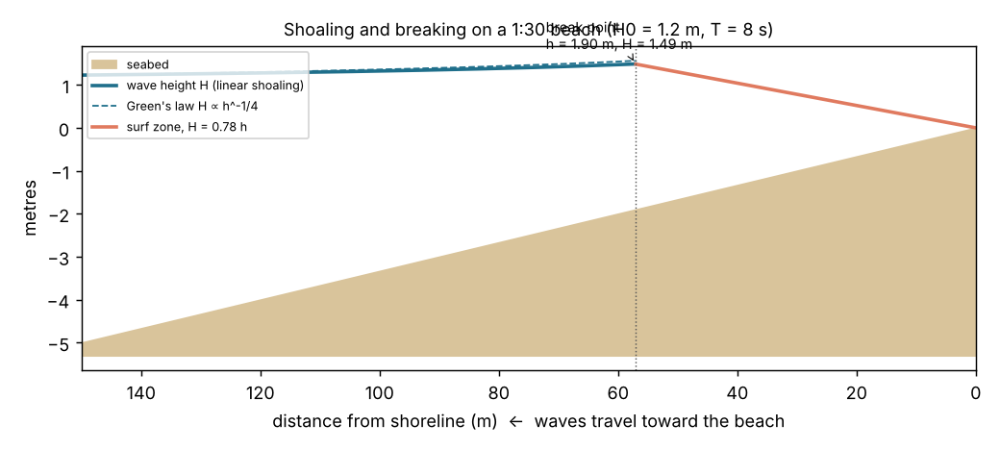
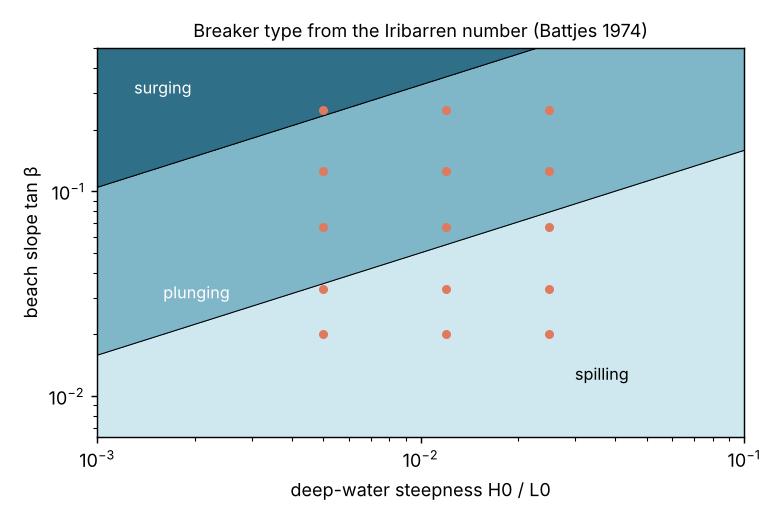
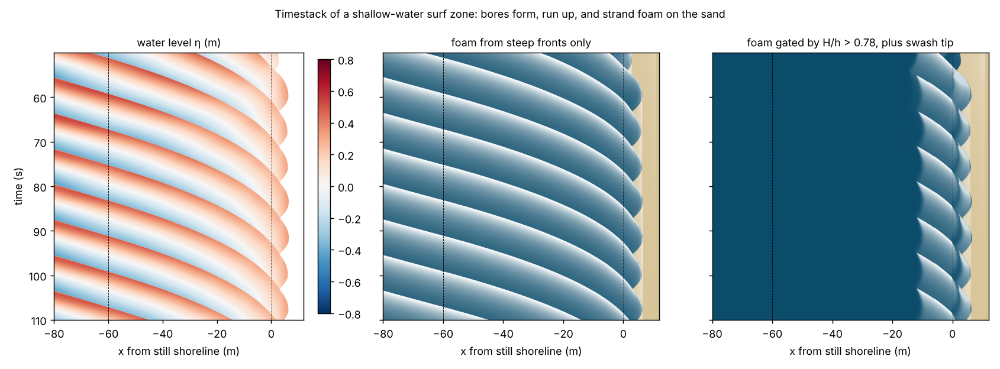
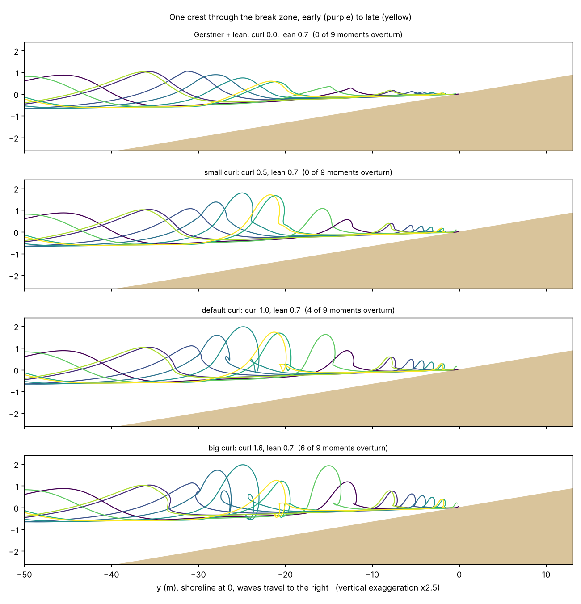

# Breaking waves, beaches and the foam they make

Research for the Seafoam project, second track: waves that curl and fall back into the water, shallow-water
waves, and waves breaking on a sand beach that leave foam as they go. It comes with experiments
([`experiments/`](../experiments)) and Blender nodes ([`blender/`](../blender)) that put the findings to work.

## Summary

- **A wave breaks because the water gets shallow.** It slows to `c = √(g·h)`, its crests bunch up, and its
  height grows (Green's law, `H ∝ h^-1/4`). It breaks when the height reaches about 0.78 × the depth
  (McCowan). The beach slope then decides *how* it breaks. The Iribarren number sorts breakers into
  spilling (gentle beaches), plunging (the curl, on steeper beaches) and surging.
- **"Colliding" is where the foam comes from.** In a plunging breaker the thrown lip collides with the water
  ahead. It traps a tube of air and splashes up again, and those jet–splash cycles are the main source of
  bubbles and foam. After that, the broken wave runs to shore as a *bore* carrying whitewater. The swash
  climbs the sand and drains away, leaving foam lines. Two related cases are covered too: a wave hitting a
  wall or rock, and two wave trains crossing.
- **Graphics fakes curls in three ways.** You can tilt or deform a parametric wave (Fournier & Reeves 1986,
  Peachey 1986). You can animate cross-section profiles (Surf's Up 2007, Moana 2017). Or you can simulate:
  2D slices driving Navier–Stokes (Mihalef 2004), shallow-water fronts with breaking patches (Thürey 2007),
  or FLIP with whitewater (Houdini). Games mostly use distance-to-shore maps and skewed Gerstner waves.
- **What we built:** a parametric wave driven by Green's law and the 0.78 limit, with Fournier–Reeves lean and a
  Moana-style curl. The curl rotates the crest around a pivot scaled by the wave height. Foam uses the
  stage 1 rule (source → persistence → decay → look), with sources timed to the breaking stage. It ships as
  Blender Geometry Nodes, alongside "old" Gerstner and Jacobian whitecap nodes.
- **Main experimental findings:**
  - Plain shallow-water equations break waves far too early, because they lack dispersion. A foam source
    built on steepness alone whitewashes the whole sea; gating it with the 0.78 rule fixes that.
  - A stretched Gerstner "loop" makes a lip as long as the wave, not as tall. A pivot curl fixes that.
  - Foam must fade within one wave period, or the surf zone saturates to solid white.

## 1. The physics, briefly

| Quantity | Formula | Meaning for the look |
|---|---|---|
| Shallow-water speed | `c = √(g h)` | Waves slow and crests bunch up toward the beach |
| Shoaling (Green's law) | `H ∝ h^(-1/4)` | Waves grow as they arrive |
| Breaking limit (McCowan 1894) | `H / h ≈ 0.78` | Where the break starts |
| Iribarren number (Battjes 1974) | `ξ0 = tanβ / √(H0 / L0)` | `< 0.5` spilling, `0.5 – 3.3` plunging, `> 3.3` surging |
| Run-up (Hunt 1959) | `R = ξ0 · H0 = tanβ · √(H0 L0)` | How far the swash climbs. The horizontal reach is `√(H0 L0)`, whatever the slope |
| Refraction (Snell) | `k · sin α = const` | Crests swing toward parallel with the shore. Oblique waves "peel" |

Experiment A ([`experiments/shoaling.py`](../experiments/shoaling.py)) runs linear wave theory over plane
beaches. A 1.2 m, 8 s swell on a 1:30 beach grows 24% and breaks 57 m out, in 1.9 m of water. Green's law
gives 1.56 m at that point against 1.49 m from full linear theory. With 8 s swell, beaches of 1:50 to 1:30
spill, 1:15 to 1:4 mostly plunge, and a small 0.5 m swell on a 1:4 beach surges.

The Iribarren classes are a rule of thumb. A 2020 laboratory study on a 1:10 slope found no one-to-one link
between the number and the breaker type, apart from clear spilling and early plunging. The 0.78 limit also
varies (0.82 in later theory, higher for strongly breaking wave groups). For stylized work both are good
defaults, exposed as controls.

### Life of a breaker, and where foam appears

| Stage | What the water does | Foam in the nodes |
|---|---|---|
| 1. Shoaling | Longer, taller, sharper crest | None |
| 2. Steepening | Front face goes vertical, crest leans forward | None (the face stays clear) |
| 3. Plunging | Lip throws forward and falls | Spray from the lip |
| 4. Impact ("collision") | Jet hits the trough, traps air, splashes up again | Whitewater starts here |
| 5. Bore (roller) | Broken wave runs shoreward as a turbulent step | Narrow whitewater band on each bore front, lace behind |
| 6. Swash and backwash | Thin sheet runs up the sand and drains | Foam at the leading edge, stranded on the sand, fading slowly |

Foam lasts because of surfactants (dissolved organic matter from algae and plants) that stabilize the bubbles.
That is why foam piles up at the swash line, and onshore wind then works it across the beach.

## 2. Colliding waves

"Colliding wave" covers three different events. All three make foam or spray.

1. **The lip hits the water ahead.** This is the plunging impact. Laboratory and numerical work identifies two
   large-scale air-entrainment features: air trapped under the falling jet, and the splash-up at the plunge
   point. Several jet–splash cycles happen within a single breaker, and each one adds bubbles. The roller then
   carries a large air–water mixing zone shoreward. Bursting bubbles from the impact are one source of spray
   droplets. *In the nodes:* whitewater turns on as breaking progress passes the plunge, and spray comes from
   the rotating lip.
2. **A wave hits a wall or rock.** It reflects into a standing wave (clapotis), up to twice the incoming height
   half a wavelength from the wall. Vertical jets form where the reflected crest meets the next incoming crest,
   about a quarter wavelength out. Oblique waves make a cross-hatched pattern. *For a future node:* superpose
   the incoming and reflected fields, with foam and spray where the combined surface rises fastest near the wall.
3. **Two wave trains cross.** Steepness adds up where crests coincide. *Already handled:* the Jacobian of a
   summed wave field (`SF Gerstner Ocean` with a wide Spread) flags exactly those spots.

## 3. How graphics does it

| Approach | Example | Curls over? | Foam | Fits Seafoam? |
|---|---|---|---|---|
| Elliptical, tilted Gerstner orbits | Fournier & Reeves 1986 | Leans and overhangs a little | None (1986) | Yes, our Lean control |
| Phase function plus depth-dependent profile, particle spray | Peachey 1986 | Profile steepens with depth | Particles for spray | Yes, our phase and spray |
| Rigged wave shapes (spline curl, blend shapes) | Surf's Up 2007 | Yes, art-directed | Simulated on top | Same idea as our curl |
| Animated cross-section profiles, or simulation | Moana 2017 ("Crashing Waves") | Yes | Simulated | Our curl is one procedural profile family |
| 2D slices set the shape, 3D Navier–Stokes continues | Mihalef et al. 2004 | Yes, physically | From the simulation | Offline only |
| Shallow water plus wave-front patches | Thürey et al. 2007 | Patches curl over | Particles | Good fit for a shallow-water backend |
| FLIP with whitewater (curvature, acceleration, vorticity) | Houdini | Yes | Spray, foam and bubbles | Offline reference |
| Shore distance map plus skewed Gerstner | Many games | Leaning crest | Texture by shore distance | Cheap alternative |
| Nonlinear shallow-water solver on the GPU | Godot "Realistic Shoreline Waves" | Bores | Advected by real velocity | Matches Experiment B |

## 4. Experiments

### B. Shallow-water run-up with foam ([`experiments/swe_runup.py`](../experiments/swe_runup.py))

This is a 1D nonlinear shallow-water solver: finite volume, hydrostatic reconstruction, Rusanov flux, MUSCL,
and wetting and drying. It runs a 0.45 m, 8 s wave train onto a 1:20 beach. Still water stays exactly still
(error around 1e-15), so the scheme is well balanced. Foam follows the stage 1 rule with real transport,
`dF/dt + u·∂F/∂x = S − F/τ`, and stranded foam lasts longer (25 s against 4 s).

| Breaking detector | Typically fires (seaward of the shoreline) |
|---|---|
| Steep front, `∂η/∂x < −0.35` | 78 m (already on the flat sea floor, 60 m is the beach toe) |
| Convergence, `−∂u/∂x > 0.6` | 79 m |
| Froude, `u / √(g h) > 0.6` | only in the swash, at the shoreline |
| Breaking switch, `H / h > 0.78` | 7.5 m |
| Linear theory plus 0.78 (Experiment A) | 30 m |

**Finding.** The shallow-water equations have no dispersion, so every wave steepens into a bore long before a
real wave would break. A steepness-only foam source covers 55% of the surf zone and 35% of the open sea.
Gating it with the breaking switch (which hybrid Boussinesq surf models use) drops that to 9% and 0%, and keeps
the swash foam. The run-up reaches 6.6 m past the shoreline, and foam is left on the dry sand. The timestack
shows the classic parabolic swash tracks.

### C. Does the Blender node curl? ([`experiments/blender_breaker_profiles.py`](../experiments/blender_breaker_profiles.py))

This samples the `SF Shore Waves` node's cross-section as one crest crosses the break zone.

- **Pushing Gerstner steepness above 1 (a prolate trochoid)** does loop the crest. But the loop is as long as
  the horizontal displacement, about 9 m for a 1.5 m wave, so it reads as a flat hook. Rejected.
- **The Fournier–Reeves lean** steepens the face but never overturns it.
- **The pivot curl** rotates water just behind the crest up to 150° around a pivot ahead of the crest, placed
  0.3 H forward and 0.1 H up. The lip is then as big as the wave is tall. Curl 0.5 gives a vertical,
  collapsing face; 1.0 throws a lip; 1.6 closes a barrel.

### D. Tuning findings from the renders

- **Foam lifetime must be shorter than the wave period.** With 5 s foam (and broad sources) on 8 s waves the
  whole surf zone turned white; 2.5 s with narrow bore-front sources leaves blue water between bores.
- **Foam must wait for the plunge.** Starting whitewater at breaking progress 0.35, plus foam on the lip,
  painted the curling face white. Starting it at 0.55 to 0.75, after the lip lands, with no lip foam, keeps the
  face clear. That matches stage 4 above.
- **AgX turns sunlit sand grey.** It desaturates bright values. The Standard view transform plus self-lit
  (emission) toon shading keeps the stylized colours.
- **Back-lighting needs care.** A low sun ahead of the camera glares off the glossy wet sand. A side light
  reads better.
- **Frame the curl from the shoulder.** On a peeling wave the side that has not broken yet shows the curl;
  the other side is all whitewater.

## 5. The Blender nodes

The "old" nodes carry over the stage 1 open-sea technique; the "new" nodes cover this research. See the
[tutorial](../blender/TUTORIAL.md) and the [node reference](../blender/NODE_REFERENCE.md).

| Node | Old or new | What it does |
|---|---|---|
| SF Gerstner Ocean | old | Six Gerstner waves, Jacobian whitecap source |
| SF Foam Accumulate | old rule, new transport | Simulation zone: spread, fade (separate wet and dry lifetimes), drift, add source. Also takes Blender's Ocean modifier foam |
| SF Foam Look (shader) | old | The stage 1 dissolve: lace pattern thresholded by foam amount |
| SF Shore Waves | new | Green's law shoaling, 0.78 breaking, refraction and peel, lean, pivot curl, bore, swash run-up, foam and spray sources |
| SF Spray | new | Simulated droplets thrown from the lip |
| SF Beach | new | Matching sand with ripples |
| SF Water, Sand and Spray shaders | new | Toon-lit, self-lit stylized materials |

Every node is tested headless on Blender 4.5 LTS and 5.0 (27 checks: no breaking offshore, foam in the surf
zone, foam stranded on the sand, foam decay equal to `exp(−dt/τ)`, the Ocean modifier bridge, and more).

## 6. Limits and next steps

- **Plane beaches only.** The travel-time integral assumes `h = slope · s`. Real bathymetry (reefs, point
  breaks, sandbars) needs an eikonal or ray solve, or the shallow-water backend from Experiment B. On a
  straight beach, refraction makes the break peel fast (about 25 m/s at a 30° offshore angle). Slow, surfable
  peels need curved bathymetry.
- **The curl is a deformation, not a volume.** At high Curl the lip can pass through the face, and it needs a
  dense grid (0.3 m or finer).
- **No obstacles yet.** Wall and rock reflection (clapotis) and contact foam around objects are designed (§2)
  but not built. The `Geometry Proximity` node is the natural source for contact foam.
- **Spray is simple spheres.** A stylized sprite or volume look would read better close up.
- **Simulation zones play in order.** Bake them before scrubbing the timeline or rendering a frame range out
  of order.

## Sources

- Fournier, A., Reeves, W. T. (1986). *A simple model of ocean waves.* SIGGRAPH '86, 75–84.
  [PDF](https://ohiostate.pressbooks.pub/app/uploads/sites/45/2017/09/fournier-reeves.pdf),
  [DOI 10.1145/15886.15894](https://www.doi.org/10.1145/15886.15894)
- Peachey, D. R. (1986). *Modeling waves and surf.* SIGGRAPH '86, 65–74.
  [PDF](https://ohiostate.pressbooks.pub/app/uploads/sites/45/2017/09/waves-peachey.pdf),
  [ACM history page](https://history.siggraph.org/?p=116024)
- Miller, E., Bredow, R., Kramer, D., Hausman, M., Shinners, P., Carlson, D., Clark, J. (2007). *Making waves for
  Surf's Up.* SIGGRAPH 2007 Sketches. [ACM history page](https://history.siggraph.org/?p=141622);
  course notes *Surf's Up: A Practical Guide to Making Waves*
  ([listing](https://history.siggraph.org/?p=48397))
- Byun, D. J., Stomakhin, A. (2017). *Moana: Crashing Waves.* SIGGRAPH 2017 Talks.
  [Disney Animation](https://disneyanimation.com/publications/moana-crashing-waves/)
- Mihalef, V., Metaxas, D., Sussman, M. (2004). *Animation and Control of Breaking Waves.* SCA 2004.
  [PDF](https://www.math.fsu.edu/~sussman/BreakingWavesElectronic.pdf)
- Thürey, N., Müller-Fischer, M., Schirm, S., Gross, M. (2007). *Real-time Breaking Waves for Shallow Water
  Simulations.* Pacific Graphics 2007. [PDF](https://matthias-research.github.io/pages/publications/breakingWaves.pdf)
- SideFX. *Whitewater.* [Houdini docs](https://www.sidefx.com/docs/houdini/shelf/whitewater.html)
- Battjes (1974) breaker types via the [Iribarren number](https://en.wikipedia.org/wiki/Iribarren_number);
  limits of the classification: [Wave Breaker Types on a 1:10 Slope (2020)](https://www.doi.org/10.3390/JMSE8040296)
- McCowan breaking index:
  [Breaking Waves on a Macrotidal Barred Beach: A Test of McCowan's Criteria](https://journals.flvc.org/jcr/article/view/77840)
- Green's law: [Wave shoaling](https://en.wikipedia.org/wiki/Wave_shoaling),
  [Grimshaw, wave dynamics notes](https://av.fields.utoronto.ca/programs/scientific/12-13/mathofoceans/wavedynamics/grimshaw.pdf)
- Plunging-breaker air entrainment: [Deane (1999)](https://data-ww3.ifremer.fr/BIB/Deane_Stokes_JPO1999.pdf),
  [Lubin et al. (2006)](https://data-ww3.ifremer.fr/BIB/Lubin_etal_CE2006.pdf),
  [regular plunging breakers (HAL)](https://hal.archives-ouvertes.fr/hal-00193225)
- Surf-zone breaking detection in hybrid models: [Bacigaluppi, Ricchiuto, Bonneton](https://arxiv.org/pdf/1902.03021),
  [Bonneton et al.](https://arxiv.org/pdf/1004.3480)
- Beach foam: [Foam and foam lines (EPA Tasmania)](https://epa.tas.gov.au/environment/water/water-topics/foam-and-foam-lines),
  [surficial beach structures formed by foam](https://pure.ulster.ac.uk/en/publications/surficial-beach-structures-formed-by-wave-generated-foam-3/)
- Clapotis and wall jets: [Clapotis](https://en.wikipedia.org/wiki/Clapotis),
  [Southampton WEEG newsletter 46](https://hydro.soton.ac.uk/wp-content/uploads/sites/297/2021/11/WEEG-NEWSLETTER-Nr-46-10-2021.pdf)
- Game shorelines: [GameDev.net ocean rendering blog](https://gamedev.net/blogs/entry/2249487-ocean-rendering),
  [Unreal forum: shore detection](https://forums.unrealengine.com/t/shore-detection-for-water-surfaces/64505/29),
  [Godot Realistic Shoreline Waves](https://reboot16.itch.io/godot-rsw)
- Blender Ocean modifier foam: [Blender manual](https://docs.blender.org/manual/en/4.1/modeling/modifiers/physics/ocean.html)

Several sources were only reachable as abstracts or search excerpts from the research environment. Claims
from them are kept to what those excerpts state.
